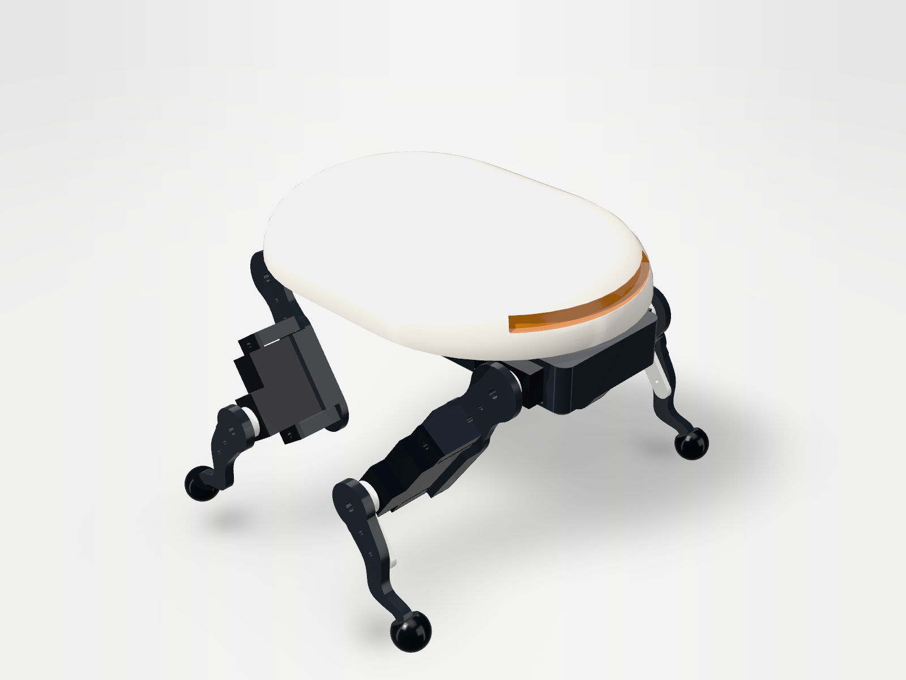
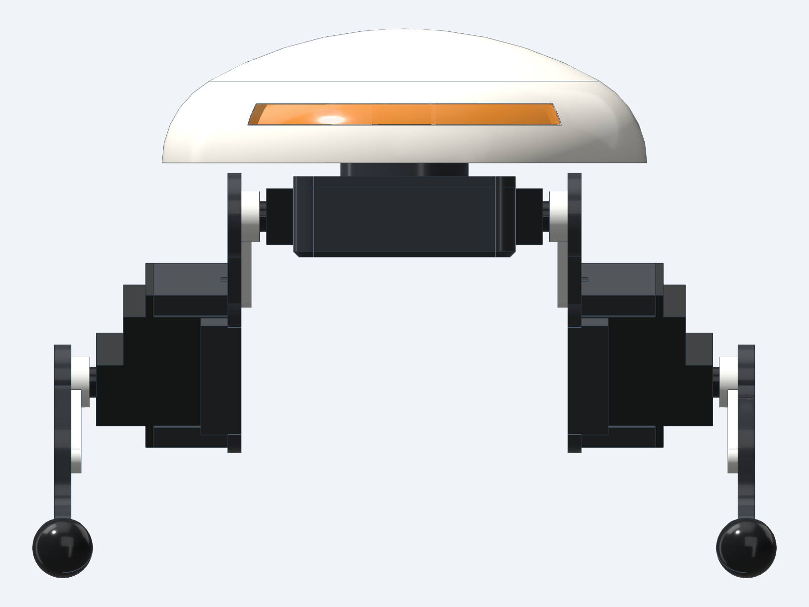
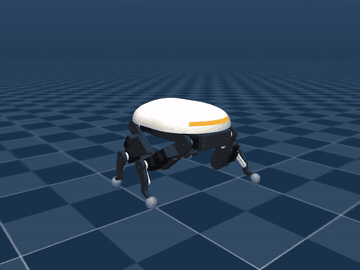
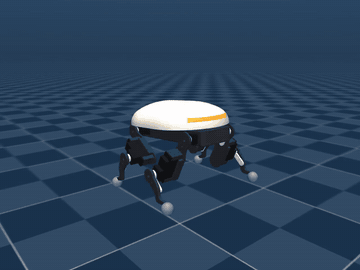
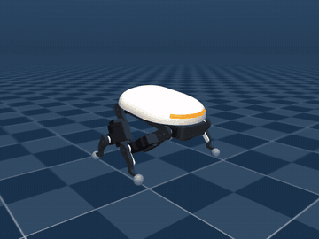

# Pebble Quad: a mini quadruped on 4 g servos

A pocket-size quadruped with a smooth river-pebble shell over all its mechanics and an amber visor
across the front. It walks, waves and sways. Designed with
[text-to-cad](https://github.com/earthtojake/text-to-cad) (build123d) and tested in MuJoCo. It has not
been built yet: everything below is design and simulation.

<p>


</p>
<p>



</p>

Videos: [trot](media/trot.mp4) · [static crawl](media/crawl.mp4) ·
[6 mm step](media/trot_step6mm.mp4) · [wave](media/wave.mp4) · [sway](media/dance.mp4).
The floor's squares are 5 cm.

| | |
|---|---|
| Size | 99 × 114 × 83 mm (length × width × height) |
| Mass | 104 g with solid printed parts (worst case; lighter with partial infill) |
| Motors | 8 servos of ~4 g: a hip and a knee on each leg |
| Legs | 30 mm thigh and 30 mm lower leg in 3.5 mm plate, bowed lower leg, 9 mm TPU ball foot; knees pointing inward (`> <`) |
| Shell | 99 × 72 mm, 1 mm wall, matte white; a press fit. A see-through amber visor across the front, with room behind it for an LED or a distance sensor |
| Battery / control | 1S 300 mAh LiPo in the chassis, a "super mini" class board under the shell |
| Printed parts | 18 (8 different): tray, deck, shell, visor, 4 thighs, 4 lower legs (2 + 2 mirrored), 4 TPU feet |

## Bill of materials

Nothing on this list has been bought or assembled yet; the quantities come from the model.

### To buy

| Qty | Component | Notes |
|---|---|---|
| 8 | ~4 g servo, 90° of travel or more | GH-S37D (3.7 g) or EMAX ES9051 (4.1 g). The pockets are sized for the ES9051; **measure yours before printing**. They usually come with horns and screws |
| 8 | Single-arm servo horn with at least 2 holes | Usually included with the servo. The model assumes an 18 × 4.6 mm arm with holes 6 and 11 mm from the shaft |
| 1 | 1S LiPo battery, ~300 mAh, size 602030 (30 × 20 × 6 mm) | The tray's bay is 31 × 21 × 8.8 mm |
| 1 | Controller board, ~22.5 × 18 mm, with **8 PWM outputs** | For example an ESP32-S3 "super mini", whose PWM generator has 8 channels ([Espressif documentation](https://docs.espressif.com/projects/esp-idf/en/v5.3.3/esp32s3/api-reference/peripherals/ledc.html)). Check that your board has them: not every board that size reaches 8 |
| 1 | 1S LiPo charger | With your battery's connector |
| 1 | Miniature slide switch | No pocket for it in the model yet |
| 4 | M1.6 × 6 self-tapping screw | Deck to tray |
| 28 | Small servo screws (~1.2 mm) | 8 horn centre screws, 12 horn arm screws (1 per thigh, 2 per lower leg) and 8 for the knee servos' tabs. They usually come with the servos, but not always that many |
| | Thin wire, battery connector, double-sided tape, glue | The board and the battery are taped; the visor is glued |

Optional: an LED or a distance sensor behind the visor.

**Power, still to decide.** Sellers of the GH-S37D give 3.6 to 4.8 V, and a 1S LiPo falls from 4.2 to
about 3.0 V, so on a low battery the servo is below its minimum. The options are to accept a shorter
run time or to add a small boost converter, which is in neither the model nor the mass. The board
also needs its own regulated supply from the battery.

### To print

| Qty | Part | Material | Volume each | Notes |
|---|---|---|---|---|
| 1 | Tray | PLA | 12.3 cm³ | No support |
| 1 | Deck | PLA | 5.7 cm³ | No support |
| 1 | Shell | White PLA | 10.1 cm³ | Rim down, with support inside |
| 1 | Visor | Amber see-through PETG | 0.3 cm³ | Standing on its lower edge |
| 4 | Thigh | PLA | 2.9 cm³ | Flat, no support |
| 2 + 2 | Lower leg, versions A and B (mirrored) | PLA | 0.8 cm³ | A: front left and rear right. B: the other two |
| 4 | Foot | TPU 95A | 0.3 cm³ | Flat face down |

About 43 cm³ of PLA in all (53 g printed solid), plus the shell's support. Print the leg parts with
high infill: the stress analysis takes them as solid.

## What it does (in simulation)

With the weakest servo of its class (0.5 kg·cm and 0.12 s/60°, what sellers quote for the GH-S37D at
3.6 V), 82 tests of 8 s each:

| Test | Result |
|---|---|
| Default trot (2 Hz, 20 mm step, 5 mm foot lift) | 83 mm/s, pitch ±4°, mean load 22 % of stall torque |
| Fastest trot tried (4 Hz, 36 mm step) | 205 mm/s, with the servos asking for full torque 60 % of the time |
| High-step trot (8 mm foot lift) | 66 mm/s, pitch ±6° |
| Static crawl, 3 feet down (1 Hz) | 24 mm/s, pitch ±2° |
| **Wave**: sits back and waves a front leg | the paw rises 28 mm; the body stays in place |
| **Sway**: bobs and rocks with all four feet on the floor | 6 s without losing its balance |
| Floor friction 0.2 to 1.2 | trots across the range (83 to 89 mm/s) |
| Payload +60 / +300 g | trots (83 / 70 mm/s) |
| Servos of 0.3 / 0.15 / 0.1 kg·cm | trots (83 / 88 / 65 mm/s) |
| Servos of 0.03 kg·cm (a test made to fail) | does not advance |
| Uphill, trot | 10° yes; 15° and 20° only leaning into the slope |
| Downhill, trot | 10° and 20° yes |
| Uphill, static crawl, leaning | 10°, 15° and 20° yes |
| Step up | 4 mm with an 8 mm foot lift; 6 mm with a 14 mm foot lift or the static crawl; stuck at 8 mm |
| Turning (a shorter stride on one side) | 26 to 41 °/s |
| Side push for 0.1 s | stands 2 N; 4 N tips it over |

Every number: [results/RESULTS.md](results/RESULTS.md).

## Do the legs and servos hold it?

**The servos do, with margin.** Holding the robot in a trot takes about 0.0085 N·m at the knee
(0.5 N per foot × 17 mm), 17 % of a 0.5 kg·cm servo's stall torque; moving, the mean load is 22 %.
It still trots with 0.1 kg·cm servos and with 300 g on top.

**The legs do for walking, not for drops.** The force on each foot was measured in simulation
(`src/foot_loads.py`), and one whole leg was analysed under those forces by finite elements
(`src/leg_study.py`, cases in `fea/`): horn, thigh, knee servo and lower leg, with the knee locked.
The first version (2 and 2.5 mm plates) **did not pass**: the thigh yielded at 10 N on the foot. It
was thickened to 3.5 mm, and a screw hole was taken out of its most loaded region.

| Situation | Peak force on a foot | Safety factor of the thigh (the most loaded printed part) |
|---|---|---|
| Standing | 0.25 N | over 40 |
| Default trot, 99 % of the time | up to 1.4 N | 9 |
| Default trot, worst spike | 3.9 N, and 2.1 N sideways | 3.2 |
| Static crawl, worst spike | 2.3 N | 5.5 |
| Fastest trot (4 Hz, 36 mm), worst spike | 8.6 N, and 3.5 N sideways | 1.5 |
| A 5 cm drop onto its feet | 12 N | 2.0 |
| A 10 cm drop onto its feet | 18 N | 1.4 |

The factor is PLA's yield strength (45 MPa) over the peak stress. Under 2 there is no margin for
what the analysis does not see.

What the analysis **cannot** vouch for:

- **The hip servos' output shaft.** The leg hangs sideways off that shaft, about 29 mm out, and the
  foot's force bends it. It could not be modelled (its material and its support inside the servo are
  unknown). An estimate as a 4.6 mm bar gives about 22 MPa at the default trot's worst spike and over
  55 MPa in a 10 cm drop. It is the likeliest weak point of the real robot.
- **Impact and fatigue.** The analysis is static and linear. The impact forces come from a
  simulation with rigid contact: on the real robot the TPU foot and the gears' backlash soften
  them, by an unknown amount.
- **The joints.** Screws and horns are taken as bonded. A printed part is weaker across its layers
  than along them; here the plates are loaded along their layers.

In short: walking and the tricks are within what it holds; the fastest trot is marginal; do not drop
it from more than a few centimetres.

### What was learned

- **Torque is not the limit.** With the foot under the hip, the knee's lever arm is 17 mm and the
  weight is shared by two legs.
- **Side load is.** The legs stand out from the body as cantilevers, so every footfall bends the
  thigh and the hip servo's shaft. That is what sets the plates' thickness.
- **An open-loop trot rocks**: on two diagonal feet the body falls towards a foot in the air. A low
  foot lift (5 mm) keeps it smooth.
- **A side's two legs can hit each other** when both hips turn more than about 25° inward at once.
  The gaits do not go there, and `gait.legs_clear()` checks it on every servo command.

## Before you build it

- **Measure a real servo before printing.** Only the envelope (19.74 × 8.34 × 23.25 mm, EMAX ES9051;
  the GH-S37D, 20.05 × 8.75 × 22 mm, fits the same pockets) comes from seller listings. The tab
  height, the gear cap and the shaft's position are assumed proportions. All of it is in
  `src/params.py`. That is why no STL files are included.
- **The shell needs support inside.** It is a low dome: it prints rim down and its ceiling (25 % of
  its surface) overhangs. The support goes inside, where it is not seen. Every other part prints
  without support; the visor in see-through PETG.
- **The servo data is from sellers**, not a datasheet, and the listings disagree (0.5 to
  0.8 kg·cm). The simulation uses the low figure.
- **The servo model in simulation is estimated**, not measured: loop gain, rotor inertia and gear
  friction. It has no backlash or dead band, and the parts are rigid.
- **Everything is open loop**: no IMU, no sensors.
- **Build details are missing**: cable routes, a pocket for the switch, and the power supply (see
  the bill of materials).
- The servos turn ±45° in the model (a 90° servo). Every axis turns about +Y; on the real robot the
  right-hand servos are mirrored and the firmware must invert them.

## Checks made

| What | How | Result |
|---|---|---|
| No part passes through another during the moves | `cad model interference` at 51 poses: standing, crouched, and along the trot, crawl, wave and sway | no interference |
| The interference check can fail | a servo pushed 1 mm into the tray | detected (124 mm³) |
| Extreme poses | both hips of a side 25°–45° inward | the legs meet from 25°–30°, depending on the knees |
| The leg-clearance guard | `python3 src/check_guard.py <id>`: 40 random poses against the CAD | 10 collide and it refuses them all; it also refuses 2 that do not |
| Joint travel | `cad model ranges`, each joint alone | knees clear; hips −154° to +60° (the shell is the stop), wider than the servo's ±45° |
| Parts printable in FDM | `cad model dfm --process printing` on the 8 parts | 6 with no warnings; the shell with overhang warnings (ceiling and visor slit); the visor with one (its tips print rounded) |
| Stress in a leg | `cad model solve` (netgen + CalculiX), 3 cases with 10 N on the foot | with no side load, every printed part at a factor of 2.5 or more; with 5 N sideways, thigh 1.3 and lower leg 1.9 |
| Simulation model health | `cad mujoco check sim/scene.xml` | no warnings |
| Kinematics and moves | `python3 src/gait.py` | error under 1e-13 mm; all 4 moves within ±45° and keeping the legs apart |

Not checked: the shell's press fit, the visor's fit, the hip servos' shaft, or anything on real
hardware.

## Files

```
src/params.py        dimensions (servo, legs, chassis)
src/parts.py         parts: servo, horn, tray, deck, thigh, lower legs, foot, shell, visor
src/robot.py         assembly with its 8 joints, poses and moves
src/gait.py          inverse kinematics, trot, crawl, wave, sway and the leg-clearance guard (pure Python)
src/check_guard.py   holds the leg-clearance guard to the CAD
src/quad_mujoco.py   simulation model: collisions, servos, actuators
src/walk_sim.py      tests and videos
src/foot_loads.py    peak forces on the feet (gaits and drops)
src/leg_study.py     one leg's model for the stress analysis
fea/                 the 3 load cases and their results
scripts/             text-to-cad installer
sim/                 generated MuJoCo model (quad.xml, meshes) and the scene (scene.xml)
results/             test results
```

## Reproducing it

It needs text-to-cad. This script installs it for Claude Code and Codex (pinned release, installer
verified by checksum, telemetry off); `cad uninstall` removes it:

```bash
sh scripts/install-text-to-cad.sh
```

Then, from the repository's root:

```bash
cad run src/robot.py
```

```bash
cad run src/quad_mujoco.py
```

```bash
cad run src/walk_sim.py --suite
```

One move (`trot`, `crawl`, `wave` or `dance`) with a video; it needs a display (on a server, `xvfb`):

```bash
xvfb-run -a env MUJOCO_GL=glfw cad run src/walk_sim.py --gait wave --video media/wave.mp4
```

`cad run src/robot.py` prints the link to the 3D viewer, where the joints can be moved and the four
moves played. For print files, with the `id` each part prints from `cad run src/parts.py`:
`cad model export <id> STL/part.stl`.

## Sources of the servo data

- EMAX ES9051: [Aloft Hobbies](https://alofthobbies.com/emax-es-9051.html),
  [Motorobit](https://www.motorobit.com/emax-es9051-digital-mini-servo-motor-en)
- GH-S37D: [Wishiot manual](https://manuals.plus/asin/B0BFQLMTGW),
  [Zbotic](https://zbotic.in/product/micro-servo-37g-gh-s37d-90-degree/)

## License

[MIT](LICENSE).
