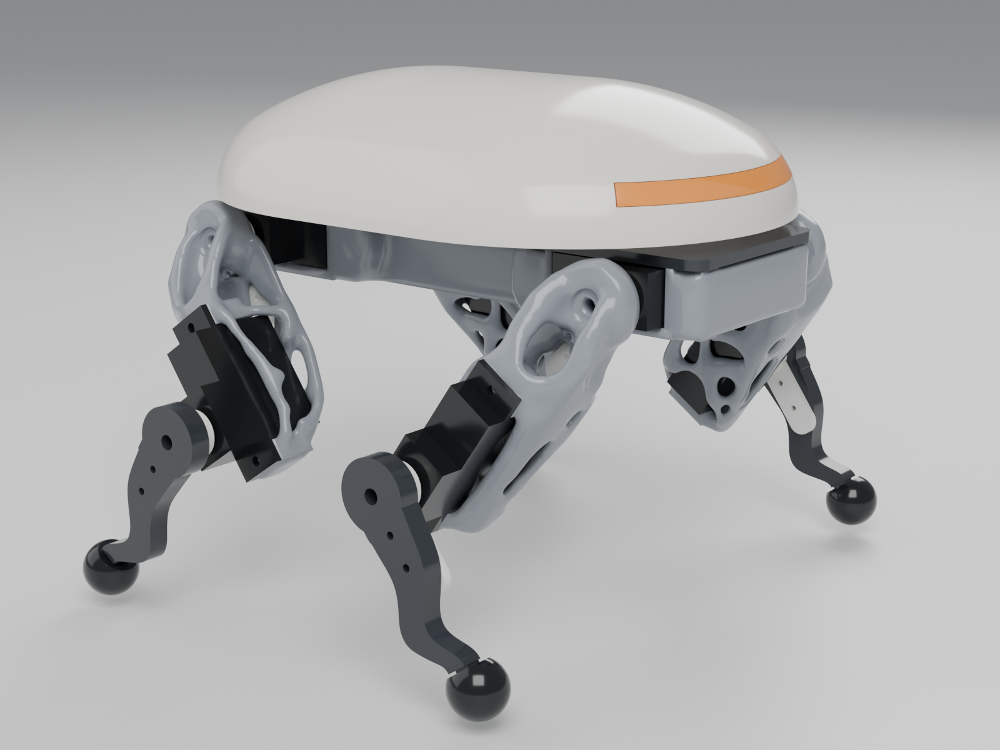
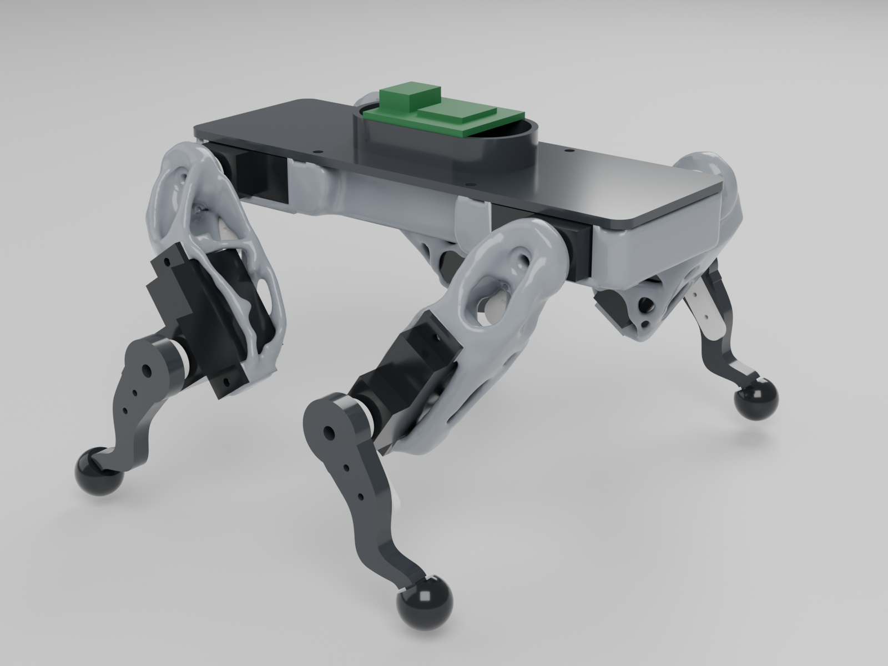
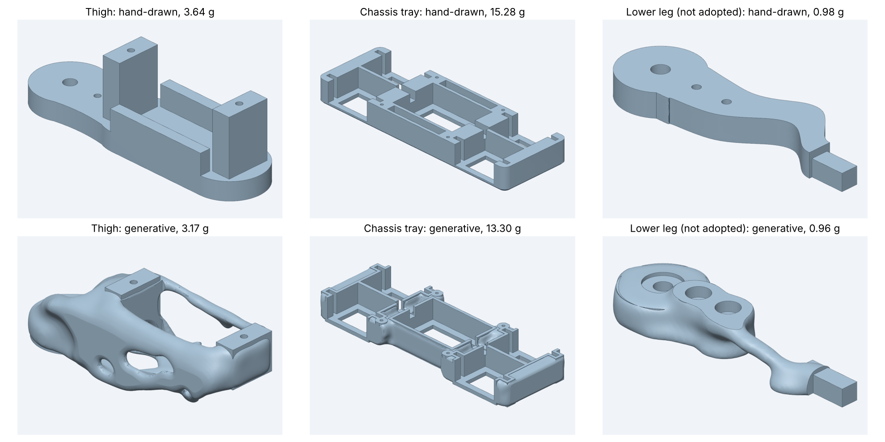

# Generative parts: an experiment

Can this robot's structural parts be *grown* instead of drawn? This folder holds a pipeline that does it
with free tools, the parts it produced, a second build of the robot that uses them (`quad_v2`), and the
numbers that compare both builds. The hand-drawn robot in `src/` is unchanged and remains the reference.

<p>


</p>
<p>

</p>

Video: [the generative build trotting](media/trot_v2.mp4).

## Result in one table

| | Hand-drawn (`src/`) | Generative build (`quad_v2`) |
|---|---|---|
| Thigh, each | 3.64 g | **3.17 g (−13 %)** |
| Thigh stiffness, 4 load cases | 1 | **×4.3, ×5.1, ×1.5, ×2.0** |
| Thigh indicative stress, same cases | 1 | ×0.38, ×0.35, ×1.17, ×0.70 |
| Chassis tray | 15.28 g | **13.30 g (−13 %)** |
| Tray stiffness, 2 load cases | 1 | ×0.99, ×1.00 |
| Tray indicative stress, same cases | 1 | ×1.03, ×1.07 |
| Lower leg, each | 0.98 g | the same part: the grown one was worse |
| Robot | 103.7 g | 99.8 g (−3.9 g) |
| Size | 99 × 114 × 83 mm | the same |
| Printing the thigh and the tray | as modelled, no supports, no warnings | pass the FDM check with overhang warnings; supports of about 1215 mm³ per thigh (half its own volume) and 51 mm³ for the tray |
| Trot on flat ground | 83 mm/s, servo load 22 % rms | 82 mm/s, 22 % rms |
| Walking tests (82) | reference | 79 with the same verdict; 3 marginal ones worse |
| Strength | stress analysis of a leg, safety factors (`fea/`) | compared on voxels only: no safety factor |
| To change a dimension | edit a number | run the pipeline again, about 10 minutes a part |

Read the stiffness and stress columns as ratios between the two designs of a part: both are solved on the
same voxels with the same loads, but voxel models are rough and neither number is a safety factor. The
hand-drawn leg has a proper stress analysis (`fea/`, CalculiX); the generative parts do not.

## What the pipeline does

Each part is described once, as plain data, in `problems.py`: the box it may fill, the keep-outs (servos,
screw heads, the battery, the foot), the crisp features it must keep (bosses, seats, pocket walls), where it
is held, and its load cases (forces at the foot, from `src/foot_loads.py`'s simulation peaks). Five steps
read that description:

| Step | Script | What it does |
|---|---|---|
| 1 | `optimize.py` | Topology optimization (SIMP, [PyTopo3D](https://github.com/jihoonkim888/PyTopo3D)) for all the load cases at once: one stiffness assembly and factorization per iteration, one solve per case; the objective is the sum of the cases' compliances, each as a share of its starting value. The crisp features are held solid |
| 2 | `cleanup.py` | Makes the density field buildable with distance-field operations on a 0.25 mm grid: grows what is thinner than the minimum wall, melts the crisp features in, cuts keep-outs and holes exactly, fills cracks and bubbles, drops slivers, and prunes material that stores no strain energy in any load case (stubs of half-formed members) |
| 3 | `finish_blender.py` | Blender: voxel remesh, smooth, swell back, remesh, subdivide; then exact booleans restore the crisp features, the envelope and the cuts. Retries with another skin if the surface comes out open |
| 4 | `evaluate.py` | Samples the hand-drawn part and the generative one on the same voxels and solves both for every load case: mass, compliance, indicative stress |
| 5 | `lite.py` | Writes a light copy of each mesh (3000 triangles, cut by the keep-outs again) that `quad_v2.py` turns into a faceted solid: a CAD document holds B-rep, not meshes |

`fe.py` is the voxel finite-element model steps 2 and 4 share, `blender_ops.py` the Blender helpers of
steps 3 and 5, and `run.sh` runs steps 1 to 4 for the parts named.

## What it showed

- **Thigh: adopted.** The optimizer does not carry the knee servo on a flat plate: it wraps it in a cradle
  with rails to both tabs. It is 13 % lighter (3.17 g
  against 3.64 g) and stiffer in all four load cases, by 4.3, 5.1, 1.5 and 2.0 times. Its indicative stress
  falls in three cases and rises 17 % in the gentlest (10 N up and 5 N inward on the foot).
- **Chassis tray: adopted.** Most of the tray is pocket walls that must exist, so there is less to gain:
  the grown tray is 13 % lighter (13.30 g against 15.28 g) at the same stiffness (0.99 and 1.00 times) and
  3 to 7 % more indicative stress.
- **Lower leg: not adopted.** Its mandatory features (hub, screw bosses, the foot's peg) use up the budget,
  and what is left is a simple tapered beam, which the hand-drawn plate already is. At the hand-drawn part's
  mass the grown leg was 3 to 7 times less stiff, and at a third more mass it was still less stiff in one
  case of four. `quad_v2` keeps the hand-drawn lower legs.
- **One load case is not enough.** A thigh grown for the governing case alone (10 N up and 5 N outward on
  the foot) was 6 times stiffer in that case and 30 % less stiff than the plate in two others. All the
  results here are grown for every case at once.
- **Printability is the price.** The hand-drawn thigh and tray print as modelled with no supports. The
  grown parts pass the FDM check but need supports, and they are meshes: changing a dimension means running
  the pipeline again (about ten minutes a part), not editing a number.

## The second build

`quad_v2.py` assembles the robot from `src/robot.py`'s `assemble()` with the grown thighs and tray, and goes
through the hand-drawn robot's checks (`checks.sh`):

| Check | Hand-drawn | Generative build |
|---|---|---|
| Interference at 51 poses (as built, standing, crouched, 12 along each move) | none | none |
| Leg-clearance guard against the CAD, 40 random poses | 10 collide, all refused | 9 collide, all refused (and 3 clear ones) |
| Joint travel, each joint alone | knees clear; hips −154° to +60° | knees clear; hips −151° to +55° |
| FDM printability of the changed parts | no warnings | OK: thigh 8 warnings, thinnest wall 0.93 mm; tray 7 warnings, thinnest wall 1.2 mm |
| Simulation model (`cad mujoco check`) | no warnings | no warnings |
| Walking tests | 63 walk, 4 climb, 1 falls | 61 walk, 3 climb, 2 fall |

The three walking tests that changed are marginal ones, and all for the worse: the crawl up a 20° slope (walked,
now does not advance), the 4 mm step with an 8 mm lift (climbed, now stuck) and the 2 N side push (walked on,
now falls). On flat ground the two builds walk alike: 4 g on 104 g does not show in the servo load.

Not checked, beyond what the hand-drawn robot leaves unchecked: the grown parts' real strength (no stress
analysis with safety factors), their print (supports, orientation, time), and the light copies' fidelity
beyond their volume (within 0.5 % of the full meshes).

## Running it

```bash
python3 -m venv .venv && .venv/bin/pip install pytopo3d pypardiso scikit-image trimesh rtree matplotlib
```

```bash
PY=.venv/bin/python sh generative/run.sh thigh tray
```

```bash
cad run generative/lite.py thigh && cad run generative/lite.py tray
```

```bash
sh generative/checks.sh
```

The baselines `evaluate.py` compares with are exports of the hand-drawn parts:
`cad model export <id> generative/out/v1_<part>.stl --tolerance 0.02` (`cad run src/parts.py` prints the ids).

## Files

```
problems.py           the parts as design problems: envelope, keep-outs, crisp features, supports, load cases
optimize.py           step 1: topology optimization for all load cases
cleanup.py            step 2: distance-field cleanup and pruning
finish_blender.py     step 3: Blender finishing and exact booleans
evaluate.py           step 4: hand-drawn against generative on the same voxels
lite.py               step 5: light copies for the CAD assembly
fe.py, blender_ops.py shared by the steps
check_mesh.py         is a mesh one closed body?
compare_pictures.py   the side-by-side picture
quad_v2.py            the generative build of the robot
quad_v2_mujoco.py     its simulation model
render.py             its pictures
checks.sh             its checks
parts/                the meshes to print (<part>.stl) and their light copies (<part>_lite.stl)
sim/, results/        the generated MuJoCo model and the walking tests' results
out/                  intermediate files (not kept)
```
